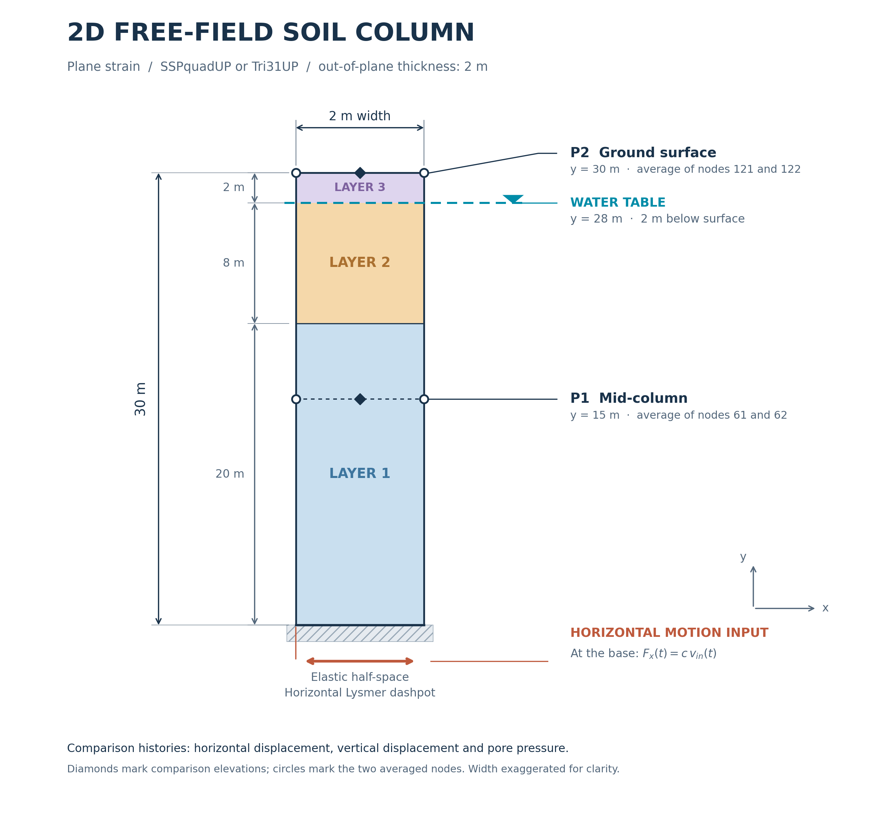

Two-dimensional free-field element comparison
=============================================

This example compares the gravity and dynamic plane-strain free-field
response of a soil column using :ref:`SSPquadUP` and :ref:`Tri31UP`.
Dynamic displacement and pore-water pressure histories are compared
at mid-column and at the ground surface.

   Soil column used for the two-dimensional free-field response comparison.

Tcl model files
---------------

* :download:`SSPquadUP <freeField2D_SSPquadUP.tcl>`
* :download:`Tri31UP <freeField2D_Tri31UP.tcl>`

Input velocity record used by both Tcl models:
:download:`yerbaNSvelocity.out <yerbaNSvelocity.out>`.
Save this file in the same directory as the Tcl model files.

Python scripts
--------------

* :download:`Gravity-response comparison <plot_gravity_results_comparison_2D.py>`
* :download:`Dynamic-history comparison <plot_dynamic_history_comparison_2D.py>`
* :download:`Shared plotting utility <freefield_plot_utils.py>`
* :download:`Column schematic <freeField2D_schematic.py>`
* :download:`Mesh comparison <freeField2D_meshes.py>`

Keep the Python scripts together beside the ``results`` directory generated
by the Tcl models. The plotting scripts require NumPy and Matplotlib.
