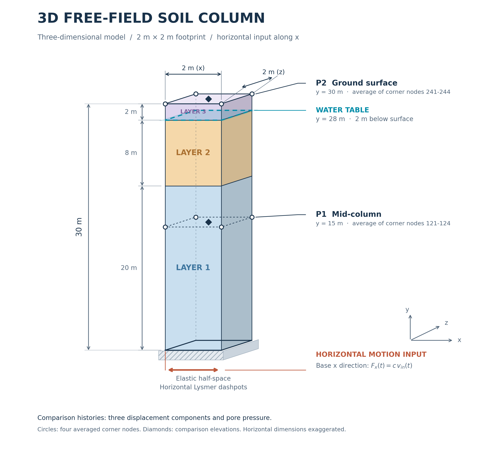

Three-dimensional free-field element comparison
===============================================

This example compares the gravity and dynamic free-field response of a soil
column using :ref:`SSPbrickUP`, :ref:`brickUP <BrickUP>`,
:ref:`TenNodeTetrahedronUP`, and :ref:`SSPtetUP`. A mixed
``SSPbrickUP`` / ``SSPtetUP`` model is also included.

   Soil column used for the free-field response comparison.

Tcl model files
---------------

* :download:`SSPbrickUP <freeField3D_SSPbrickUP.tcl>`
* :download:`brickUP <freeField3D_BrickUP.tcl>`
* :download:`TenNodeTetrahedronUP <freeField3D_TenNodeTetrahedronUP.tcl>`
* :download:`SSPtetUP <freeField3D_SSPtetUP.tcl>`
* :download:`Mixed SSPbrickUP / SSPtetUP <freeField3D_mixed.tcl>`

Input velocity record used by all Tcl models:
:download:`yerbaNSvelocity.out <yerbaNSvelocity.out>`.
Save this file in the same directory as the Tcl model files.

Python scripts
--------------

* :download:`Gravity-response comparison <plot_gravity_results_comparison_3D.py>`
* :download:`Dynamic-history comparison <plot_dynamic_history_comparison_3D.py>`
* :download:`Shared plotting utility <freefield_plot_utils.py>`
* :download:`Column schematic <freeField3D_schematic.py>`
* :download:`Mesh comparison <freeField3D_meshes.py>`

Keep the Python scripts together beside the ``results`` directory generated
by the Tcl models. The plotting scripts require NumPy and Matplotlib.
