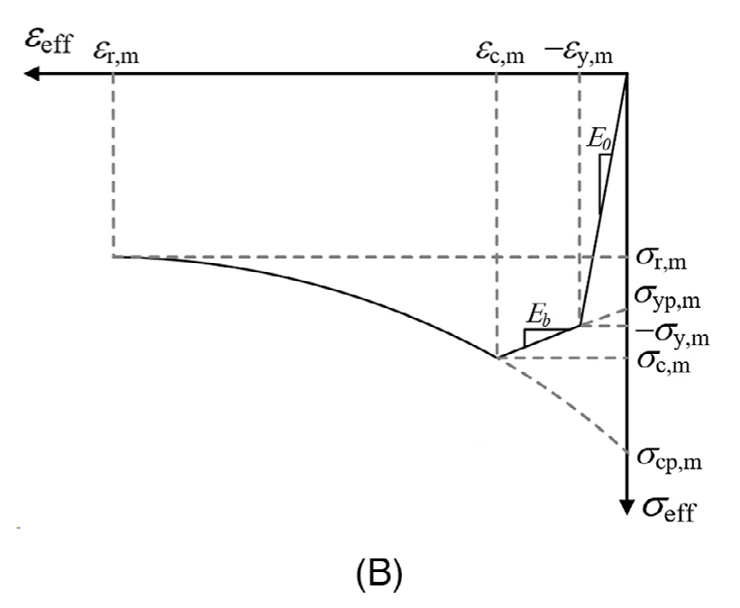
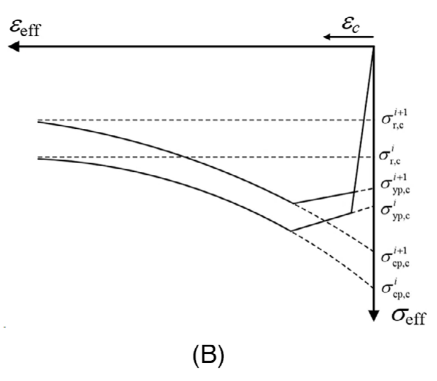
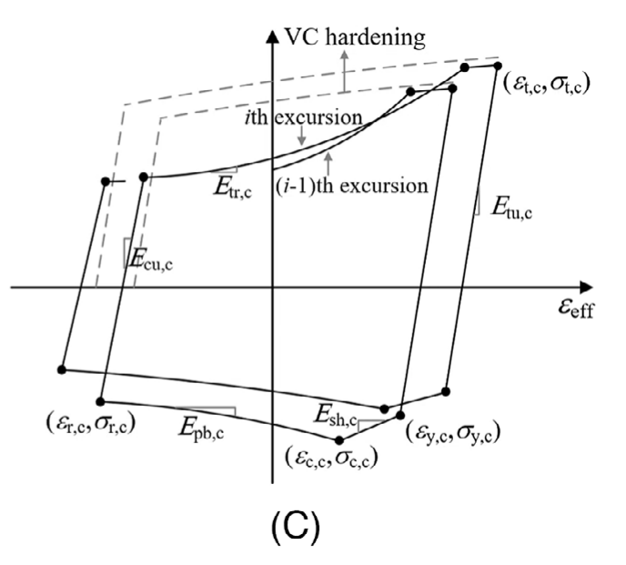
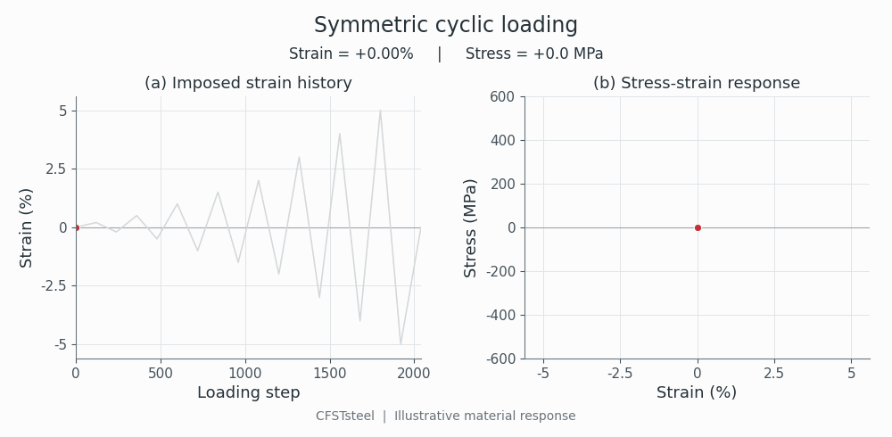

.. _CFSTsteel:

CFSTsteel Material
^^^^^^^^^^^^^^^^^^

This command constructs a uniaxial steel material for concrete-filled steel
tube (CFST) members and bare steel members, including hollow structural
sections (HSS) and H-sections. The constitutive formulation captures strain
softening induced by local buckling and the associated cyclic deterioration
of strength and stiffness. The material parameters should be calibrated for
the cross-sectional characteristics and confinement conditions.

.. code-block:: text

   uniaxialMaterial CFSTsteel $matTag $E0 $fy
       $b2 $sigma_cm $a $sigma_rm $b3
       $Lambda_t $Lambda_cp $Lambda_a
       $Lambda_yp $Lambda_r
       $c_t $c_cp $c_a $c_yp $c_r
       $Qinf $b $N
       $C1 $gamma1 ... $CN $gammaN

.. csv-table::
   :header: "Argument", "Type", "Description (units)"
   :widths: 22, 12, 66

   "$matTag", "integer", "Unique material tag (-)."
   "$E0", "float", "Young's modulus; positive (stress)."
   "$fy", "float", "Initial yield stress; positive (stress)."
   "$b2", "float", "Compressive strain-hardening ratio; positive (-)."
   "$sigma_cm", "float", "Initial compressive capping stress; negative (stress)."
   "$a", "float", "Post-buckling softening rate; positive (-)."
   "$sigma_rm", "float", "Residual compressive stress; sigma_cm < sigma_rm < 0 (stress)."
   "$b3", "float", "Post-buckling tensile reloading strength and stiffness parameter; positive (-)."
   "$Lambda_t", "float", "Reference cumulative strain capacity for tensile strength (-)."
   "$Lambda_cp", "float", "Reference cumulative strain capacity for compressive capping strength (-)."
   "$Lambda_a", "float", "Reference cumulative strain capacity for post-buckling softening (-)."
   "$Lambda_yp", "float", "Reference cumulative strain capacity for compressive strain hardening (-)."
   "$Lambda_r", "float", "Reference cumulative strain capacity for residual strength (-)."
   "$c_t", "float", "Cyclic deterioration exponent for tensile strength (-)."
   "$c_cp", "float", "Cyclic deterioration exponent for compressive capping strength (-)."
   "$c_a", "float", "Cyclic deterioration exponent for post-buckling softening (-)."
   "$c_yp", "float", "Cyclic deterioration exponent for compressive strain hardening (-)."
   "$c_r", "float", "Cyclic deterioration exponent for residual strength (-)."
   "$Qinf", "float", "Isotropic hardening saturation magnitude; nonnegative (stress)."
   "$b", "float", "Isotropic hardening saturation rate; nonnegative (-)."
   "$N", "integer", "Number of backstresses; 0 to 8 (-)."
   "$Ck", "float", "Kinematic hardening modulus for backstress k; nonnegative (stress)."
   "$gammak", "float", "Kinematic hardening saturation rate for backstress k; positive (-)."

.. note::

   Tension is positive and compression is negative. Use consistent stress
   units and dimensionless strains; (-) denotes a dimensionless parameter.
   All ``Lambda`` and ``c`` parameters must be positive. Supply all scalar
   arguments in the stated order in one command, followed by exactly ``N``
   pairs of ``Ck gammak``; omit the pairs when ``N = 0``. No defaults are
   inserted automatically.

Model behavior
""""""""""""""

   Compressive backbone (Wang et al., 2024, Fig. 6B).

   Compressive backbone deterioration (Wang et al., 2024, Fig. 7B).

   Cyclic strength and stiffness deterioration (Wang et al., 2024, Fig. 7C).

Cyclic response
"""""""""""""""

The moving points show the imposed strain and corresponding stress at the
same loading step. The animation uses the original example parameters below.

   Symmetric strain cycles with increasing amplitudes.

Example
"""""""

The original example parameters use MPa. Select parameters for the member being modeled.

.. tabs::

   .. code-tab:: tcl

      set matArgs {
          206000.0 305.0
          0.02 -342.07 26.58 -74.87 3.16
          4.07 6.38 3.12 2.36 5.82
          1.0 1.0 1.0 1.0 1.0
          116.39 11.81 1 4467.68 38.39
      }
      uniaxialMaterial CFSTsteel 1 {*}$matArgs

   .. code-tab:: python

      import openseespy.opensees as ops

      ops.uniaxialMaterial(
          'CFSTsteel', 1,
          206000.0, 305.0,
          0.02, -342.07, 26.58, -74.87, 3.16,
          4.07, 6.38, 3.12, 2.36, 5.82,
          1.0, 1.0, 1.0, 1.0, 1.0,
          116.39, 11.81,
          1, 4467.68, 38.39,
      )

References
""""""""""

Wang, S., Wang, W., and Lignos, D. G. (2024). "Uniaxial material model with
softening for simulating the cyclic behavior of steel tubes in concrete-filled
steel tube beam-columns." *Earthquake Engineering & Structural Dynamics*,
53(13), 4032-4053. https://doi.org/10.1002/eqe.4204.

Hartloper, A. R., de Castro e Sousa, A., and Lignos, D. G. (2021).
"Constitutive modeling of structural steels: nonlinear isotropic/kinematic
hardening material model and its calibration." *Journal of Structural
Engineering*, 147(4), 04021031.
https://doi.org/10.1061/(ASCE)ST.1943-541X.0002964.

.. Image attribution retained in the documentation source:
   Model diagrams reproduced from Wang et al. (2024), Figs. 6B, 7B and 7C.
   Copyright 2024 The Authors; published by John Wiley & Sons Ltd.
   Creative Commons Attribution-NonCommercial 4.0:
   https://creativecommons.org/licenses/by-nc/4.0/

Code developed by **Shiye Wang**, National University of Singapore (NUS).
