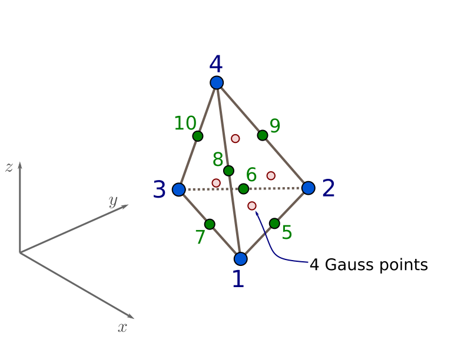

.. _TenNodeTetrahedron:

TenNodeTetrahedron Element
^^^^^^^^^^^^^^^^^^^^^^^^^^

This command is used to construct a ten-node tetrahedron element object, which uses the standard isoparametric formulation. The two commands ``TenNodeTetrahedron`` and ``TenNodeTetrahedronStd`` create the same element and differ only in the order of mid-edge nodes 9 and 10 (see :ref:`TenNodeTetrahedronNumbering`).

.. admonition:: Command

   **element TenNodeTetrahedron $eleTag $node1 $node2 $node3 $node4 $node5 $node6 $node7 $node8 $node9 $node10 $matTag <$b1 $b2 $b3> <-doInitDisp $value>**

   **element TenNodeTetrahedronStd $eleTag $node1 $node2 $node3 $node4 $node5 $node6 $node7 $node8 $node9 $node10 $matTag <$b1 $b2 $b3> <-doInitDisp $value>**

.. csv-table::
   :header: "Argument", "Type", "Description"
   :widths: 10, 10, 40

   $eleTag, |integer|,	unique element object tag
   $node1 .. $node10, 10 |integer|, "nodes of tet: corners 1-4, then mid-edge nodes 5-10 (see :ref:`TenNodeTetrahedronNumbering` below)"
   $matTag, |integer|, tag of nDMaterial
   $b1 $b2 $b3, |listFloat|, optional: body forces in global x y z directions (default: 0.0 0.0 0.0)
   -doInitDisp $value, |integer|, "optional flag; if $value is non-zero, the nodal displacements present when the element is added to the domain are stored and subtracted from all later trial displacements before strains are computed (default: 0, i.e. disabled, so ordinary total displacements are used)"

This element is based on second-order interpolation of nodal quantities, so the strain and stress field inside the element vary linearly over the element. Four Gauss points inside the element are used for integration.

.. note::

   ``-doInitDisp`` may follow ``$matTag`` directly or any of the optional body forces ``$b1 $b2 $b3`` (earlier versions required all three body forces to be given first; otherwise the command failed with "WARNING: invalid double data").

	TenNodeTetrahedron Element Node Numbering (as drawn: ``TenNodeTetrahedronStd``; for ``TenNodeTetrahedron`` nodes 9 and 10 are swapped)

.. _TenNodeTetrahedronNumbering:

Node numbering
""""""""""""""

Corner nodes 1-4 and mid-edge nodes 5-8 are the same in both conventions. Only nodes 9 and 10 differ:

.. csv-table::
   :header: "Node", "``TenNodeTetrahedron`` (gmsh order)", "``TenNodeTetrahedronStd`` (standard order, as VTK)"
   :widths: 10, 20, 30

   5, edge 1-2, edge 1-2
   6, edge 2-3, edge 2-3
   7, edge 3-1, edge 3-1
   8, edge 1-4, edge 1-4
   9, edge 3-4, edge 2-4
   10, edge 2-4, edge 3-4

``TenNodeTetrahedron`` follows gmsh's second-order tetrahedron, so meshes exported from gmsh can be used as they
are. ``TenNodeTetrahedronStd`` takes the standard order used by VTK's quadratic tetrahedron and most other
finite-element programs and mesh formats. The element keeps the nodes in the order given, so the ``forces`` response,
the stiffness and mass matrices and the connectivity seen by recorders all follow the convention of the command used.
Giving standard-order connectivity to ``TenNodeTetrahedron`` (or gmsh-order connectivity to
``TenNodeTetrahedronStd``) puts nodes 9 and 10 on the wrong edges and produces wrong results without any error
message.

.. note::

   The figure above has always shown the standard position of nodes 9 and 10, while ``TenNodeTetrahedron`` has
   always used the gmsh one. Models written from the figure should use ``TenNodeTetrahedronStd`` (or swap nodes 9
   and 10).

Theory
""""""

The element uses the full quadratic (10-node) interpolation of the tetrahedron: the 4 corner nodes plus the 6 edge mid-side nodes shown above, giving a displacement field that is quadratic in the natural (barycentric) coordinates :math:`(\xi,\eta,\zeta,\lambda)`, with :math:`\lambda = 1-\xi-\eta-\zeta`, and a strain/stress field that varies linearly over the element.

Integration uses the classical symmetric 4-point rule for tetrahedra, exact for polynomials up to degree 2 (sufficient for the quadratic displacement field). The four sample points are the permutations of the barycentric coordinates

.. math::

   \alpha = \frac{5+3\sqrt{5}}{20} \approx 0.58541020,\qquad
   \beta  = \frac{5-\sqrt{5}}{20}  \approx 0.13819660

i.e. point :math:`k` has one barycentric coordinate equal to :math:`\alpha` and the other three equal to :math:`\beta`, each with the same natural weight :math:`w = 1/24` (so that :math:`4w = 1/6`, the volume of the reference tetrahedron in natural coordinates). For an element with straight edges, the Jacobian determinant is constant over the element and equal to :math:`6V`, where :math:`V` is the physical element volume, so that

.. math::

   \int_V f\, dV = \sum_{k=1}^{4} w\, f(\mathbf{x}_k)\, \det(J) = \sum_{k=1}^{4} \frac{1}{24} f(\mathbf{x}_k)\, (6V)

reproduces the exact element volume when :math:`f \equiv 1` (see, e.g., Keast, "Moderate degree tetrahedral quadrature formulas," *Computer Methods in Applied Mechanics and Engineering*, 55(3), 1986, for this family of quadrature rules).

Responses and parameters
""""""""""""""""""""""""

Valid queries to a ``TenNodeTetrahedron`` element (e.g. via :ref:`ElementRecorder <elementRecorder>` or the ``eleResponse`` command) are:

.. csv-table::
   :header: "Response", "Size", "Description"
   :widths: 15, 10, 40

   forces (or force), 30, "nodal resisting forces, 3 components per node, nodes 1 to 10 in order"
   stresses, 24, ":math:`(\sigma_{11},\sigma_{22},\sigma_{33},\sigma_{12},\sigma_{23},\sigma_{13})` at each of the 4 Gauss points, concatenated gp 1..4"
   strains, 24, ":math:`(\epsilon_{11},\epsilon_{22},\epsilon_{33},\epsilon_{12},\epsilon_{23},\epsilon_{13})` at each of the 4 Gauss points, concatenated gp 1..4"
   "material $gp arg1 ...", varies, "forwarded to ``setResponse`` of the NDMaterial copy at Gauss point $gp (1 to 4); ``integrPoint $gp ...`` is accepted as a synonym"

Each of the 4 Gauss points holds its own independent copy of the assigned ``nDMaterial`` (made with ``getCopy`` when the element is added to the domain). ``setParameter``/``updateParameter`` can target one copy or all of them:

.. csv-table::
   :header: "Parameter", "Description"
   :widths: 25, 50

   "material $gp arg1 ...", "forwarded to ``setParameter`` of the material copy at Gauss point $gp only (1 to 4)"
   "arg1 ... (no ``material`` keyword)", "forwarded to ``setParameter`` of all 4 material copies, so the same change is applied at every Gauss point"

.. note::

   Earlier versions of this element integrated the stiffness, mass and consistent body-force vectors over a volume **6 times smaller** than the true element volume (an erroneous extra division by 6 of the Jacobian determinant, on top of the `1/24` quadrature weights that already account for it), the ``stresses``/``strains`` element responses wrote 24 values (4 Gauss points x 6 components) into a statically-sized length-6 buffer, corrupting the heap on any call to ``eleResponse ... stresses`` or an equivalent recorder, ``-doInitDisp`` could not be used without body forces, the element could not be used in OpenSeesSP/OpenSeesMP (it was missing from the object broker and sent only 4 of its 10 nodes), analyses using the initial stiffness printed every shape-function value to the screen, ground-motion inertia loads (``UniformExcitation``) were formed for 4 nodes only, giving wrong base reactions, and elements with curved edges (mid-edge nodes off the edge midpoints, as in second-order meshes of curved boundaries) computed wrong strains because the shape-function derivatives used the corner coordinates instead of the full Jacobian. Smaller fixes in the same PR: an element with left-handed corner ordering (negative Jacobian) is now reported instead of silently giving negative stiffness and mass; ``eleResponse ... material`` without a Gauss-point number no longer crashes; the ``setDispInit`` parameter now works; a deactivated element no longer contributes initial stiffness; and ``print -JSON`` lists all 10 nodes. All of these are fixed in OpenSees PR "TenNodeTetrahedron fixes" (`#1833 <https://github.com/OpenSees/OpenSees/pull/1833>`_); the example below reproduces and checks the fix.

   This element can only be defined after a :ref:`model` with **-ndm 3 -ndf 3**

Verification
""""""""""""

:download:`example_tet10_patch.tcl <figures/TenNodeTetrahedron/example_tet10_patch.tcl>` builds a single, deliberately distorted ``TenNodeTetrahedron`` with corners at :math:`(0,0,0)`, :math:`(2,0,0)`, :math:`(0,3,0)`, :math:`(0,0,1.5)` (volume :math:`V = 2 \cdot 3 \cdot 1.5/6 = 1.5`) and runs three checks:

#. **Body-force patch test.** With a uniform body force :math:`b_3=-2.0` and all nodes restrained, the sum of the vertical reactions over all 10 nodes must equal :math:`-b_3 V = 3.0` exactly (any underintegration of the volume shows up directly here). The script prints the summed reaction and compares it to the expected value.
#. **Uniform-strain patch test.** Prescribing :math:`\epsilon_{xx}=10^{-3}` on all 10 nodes (linear displacement BC) must reproduce the exact uniform stress :math:`(\sigma_{11},\sigma_{22},\sigma_{33})=(1.2,\,0.4,\,0.4)` (with :math:`E=1000`, :math:`\nu=0.25`) identically at all 4 Gauss points; this also exercises the ``stresses`` element response (24 values) without heap corruption.
#. **Per-Gauss-point parameter targeting.** For each Gauss point in turn, ``parameter ... element 1 material $gp E`` followed by ``updateParameter`` doubles the stiffness at that point only; the stress at that Gauss point must double while the other three stay unchanged.

Running it with the OpenSees interpreter gives, on the fixed element:

.. code-block:: text

   BODYFORCE  sum Rz = 3.0000000000  expected = 3.0000000000
   STRESSES  (expect per GP: 1.2 0.4 0.4 0 0 0)
   PATCH max abs error = 3.802e-11
   SETPARAMETER  per-Gauss-point E override (E: 1000.0 -> 2000.0, scale = 2.0)
     gp=1  sigma_xx before=1.200000 after=2.400000 (expected 2.400000)  other-points-unchanged=yes
     gp=2  sigma_xx before=1.200000 after=2.400000 (expected 2.400000)  other-points-unchanged=yes
     gp=3  sigma_xx before=1.200000 after=2.400000 (expected 2.400000)  other-points-unchanged=yes
     gp=4  sigma_xx before=1.200000 after=2.400000 (expected 2.400000)  other-points-unchanged=yes
   OVERALL: PASS

:download:`example_tet10_curved_patch.tcl <figures/TenNodeTetrahedron/example_tet10_curved_patch.tcl>` repeats the
uniform-strain patch test on one element with straight edges and with its mid-edge nodes moved off the edges (by about
0.1 and 0.3), for both commands. An isoparametric element reproduces a linear displacement field exactly even when
curved, so every case must give the exact stress:

.. code-block:: text

   TenNodeTetrahedron     bump=0.0  patch max stress error = 3.802e-11   |sum nodal forces| = 2.220e-16
   TenNodeTetrahedron     bump=1.0  patch max stress error = 3.601e-11   |sum nodal forces| = 4.441e-16
   TenNodeTetrahedron     bump=3.0  patch max stress error = 3.498e-11   |sum nodal forces| = 2.220e-16
   TenNodeTetrahedronStd  bump=0.0  patch max stress error = 3.802e-11   |sum nodal forces| = 2.346e-16
   TenNodeTetrahedronStd  bump=1.0  patch max stress error = 3.508e-11   |sum nodal forces| = 2.220e-16
   TenNodeTetrahedronStd  bump=3.0  patch max stress error = 3.618e-11   |sum nodal forces| = 2.220e-16

Before the fix, the curved cases gave stress errors of 0.14-0.50 against an exact value of 1.2.

:download:`example_tet10_numbering.tcl <figures/TenNodeTetrahedron/example_tet10_numbering.tcl>` checks the two
commands against each other. It uses a curved element (mid-edge nodes moved off the edges) under an imposed
quadratic displacement field and a body force. The element is defined once with ``TenNodeTetrahedron`` and once with
``TenNodeTetrahedronStd`` (nodes 9 and 10 swapped in the command). The nodal forces must agree after swapping nodes 9
and 10, and the Gauss-point stresses must be identical. As a control, the standard-order connectivity given to
``TenNodeTetrahedron`` must disagree. The script then repeats the body-force and uniform-strain patch tests with
``TenNodeTetrahedronStd``:

.. code-block:: text

   max |force|          = 1.4035e+00
   Std forces vs gmsh (9<->10 swapped): max diff = 2.220e-16
   Std stresses vs gmsh:                max diff = 3.331e-16
   control: Std conn in TenNodeTetrahedron: max diff = 6.967e+00 (must be large)
   Std BODYFORCE sum Rz = 3.0000000000 expected 3.0
   Std PATCH max abs error = 3.802e-11

The element also runs in OpenSeesSP/OpenSeesMP. A cube meshed with 48 elements of either command gives the same
displacements in serial and in OpenSeesSP on 2, 3 and 4 processes.

.. admonition:: Example

   The following example constructs a TenNodeTetrahedron element with tag **1** between nodes **1, 2, 3, 4, 5, 6, 7, 8, 9, 10** with an nDMaterial of tag **1** and body forces given by varaiables **b1, b2, b3**.

   1. **Tcl Code**

   .. code-block:: tcl

      element TenNodeTetrahedron 1 1 2 3 4 5 6 7 8 9 10 1 $b1 $b2 $b3

   2. **Python Code**

   .. code-block:: python

      element('TenNodeTetrahedron',1, 1,2,3,4,5,6,7,8,9,10, 1, b1, b2, b3)

   3. **Standard node order** (``TenNodeTetrahedronStd``)

   .. code-block:: tcl

      element TenNodeTetrahedronStd 1 1 2 3 4 5 6 7 8 9 10 1

   .. code-block:: python

      element('TenNodeTetrahedronStd', 1, 1,2,3,4,5,6,7,8,9,10, 1)

This command is registered in both the Tcl and the (Python-backing) generic OpenSees interpreter.

Code Developed by: `José Antonio Abell <www.joseabell.com>`_ and José Luis Larenas (UANDES). For bugs and features, start a new issue on the `OpenSees github repo <https://github.com/OpenSees/OpenSees>`_ and tag me (@jaabell).
