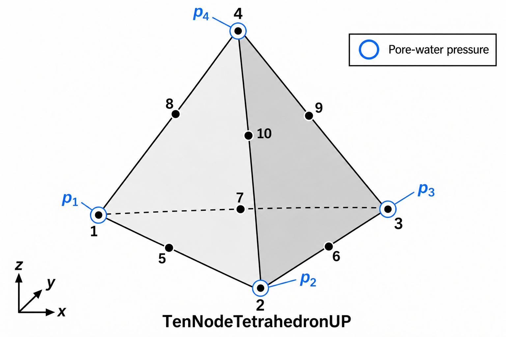

.. _TenNodeTetrahedronUP:

TenNodeTetrahedronUP Element
^^^^^^^^^^^^^^^^^^^^^^^^^^^^

This command constructs a ten-node displacement / four-node pressure
tetrahedral element for three-dimensional analysis of fluid-saturated porous
media. Quadratic displacement interpolation is used at all ten nodes and
linear pressure interpolation at the four corners. The element has 34 DOFs
and uses ND materials supporting ``ThreeDimensional`` behavior.

.. function:: element TenNodeTetrahedronUP $eleTag $N1 $N2 $N3 $N4 $N5 $N6 $N7 $N8 $N9 $N10 $matTag $bulk $fDen $k1 $k2 $k3 <$b1 $b2 $b3>

.. csv-table::
   :header: "Argument", "Type", "Description"
   :widths: 18, 12, 70

   "$eleTag", "integer", "Unique element tag."
   "$N1 ... $N4", "integer", "Four corner-node tags; each node must have four DOFs."
   "$N5 ... $N10", "integer", "Six midside-node tags in the edge order given below; each node must have three DOFs."
   "$matTag", "integer", "Tag of an ND material supporting a six-component ThreeDimensional copy."
   "$bulk", "float", "Positive combined storage bulk modulus Kc; the storage coefficient is 1/Kc."
   "$fDen", "float", "Nonnegative pore-fluid mass density."
   "$k1 $k2 $k3", "float", "Nonnegative permeability mobilities in the global x; y; and z directions."
   "$b1 $b2 $b3", "float", "Optional body accelerations in global x; y; and z; default zero."

Node ordering and model builders
~~~~~~~~~~~~~~~~~~~~~~~~~~~~~~~~

Create the corner nodes using ``-ndm 3 -ndf 4``, then switch to
``-ndm 3 -ndf 3`` to create the midside nodes. Both groups remain in the same
domain. Do not create all ten nodes with four DOFs: the element checks the
required DOF count for each node.

.. csv-table:: Midside-node order
   :header: "Node argument", "Edge between corner nodes"
   :widths: 25, 40

   "$N5", "$N1-$N2"
   "$N6", "$N2-$N3"
   "$N7", "$N3-$N1"
   "$N8", "$N1-$N4"
   "$N9", "$N3-$N4"
   "$N10", "$N2-$N4"

In particular, node 9 belongs to edge 3-4 and node 10 to edge 2-4. For a
straight-sided tetrahedron, place the six midside nodes at the edge midpoints.
Avoid degenerate or inverted geometry and verify the Jacobian throughout the
element for distorted meshes.

   TenNodeTetrahedronUP node numbering. Blue circles represent pore-water
   pressure at corner nodes 1-4. Midside nodes 5-10 have no independent
   pressure DOF. Node 9 lies on edge 3-4 and node 10 on edge 2-4;
   the dashed edge is hidden in this view.

Pressure and storage conventions
~~~~~~~~~~~~~~~~~~~~~~~~~~~~~~~~

At corner nodes, DOFs 1-3 are solid displacements and the velocity of DOF 4 is
pore pressure. Its acceleration is the pressure rate and its displacement is
the time integral of pressure. Midside nodes have displacement DOFs only and
have no independent pressure DOF. A pressure field within the element is
interpolated from the four corner pressures.

Fix DOF 4 at a corner to impose a drained boundary with initially zero pressure.
Record pressure using a Node recorder with ``-dof 4 vel`` on corner nodes only,
or use the element's ``pressure`` response.

.. important::

   ``bulk`` is a combined storage bulk modulus, not automatically the pore-fluid
   bulk modulus. The implementation forms

   .. math::

      S_{ij} = \int_{\Omega} \frac{N_i^p N_j^p}{K_c}\,dV.

   Supply :math:`K_c` corresponding to the intended storage coefficient.
   If the intended coefficient is :math:`n/K_f`, use :math:`K_c=K_f/n`.
   The element does not accept a void ratio or compute this conversion itself.

The element has no ``alpha`` argument, no added pressure-gradient stabilization
term, and no ``-lumped`` option. It uses quadratic displacement / linear pressure
interpolation rather than the equal-order stabilized formulation of ``SSPtetUP``.
Solid stiffness and coupled terms use four integration points; displacement
mass uses an 11-point rule. Four constitutive material copies are maintained.

Use a transient integrator, such as Newmark, with a general or
symmetric-indefinite solver. Pressure storage and coupling are assembled in
the generalized mass and damping matrices; static analysis alone does not
assemble the coupled pressure equations. The generalized pressure-storage
mass block is negative by the shifted u-p convention.

The material provides effective skeleton stresses and the mixture density used
for displacement inertia and gravity. ``fDen`` enters fluid gravity. Body
inputs are accelerations. The permeabilities are the mobilities in
:math:`\boldsymbol{q}=\boldsymbol{k}(-\nabla p+\rho_f\boldsymbol{b})`;
convert hydraulic conductivity using fluid unit weight when needed.
Rayleigh damping is restricted to displacement blocks. SelfWeight loads are
supported; boundary tractions and fluxes require consistent nodal loads.

Output and parameters
~~~~~~~~~~~~~~~~~~~~~

Valid :ref:`elementRecorder` queries include:

* ``force`` or ``forces``: 34-component resisting force without inertia.
  Aliases are ``globalForce`` and ``globalForces``.
* ``forceIncInertia`` or ``forcesIncInertia``: resisting force including velocity
  and acceleration terms.
* ``stress`` or ``stresses``: 24 effective-stress values, six per integration point.
* ``strain`` or ``strains``: 24 strain values, six per integration point.
* ``pressure`` or ``pressures``: four corner pressures in node order 1-4.
  Aliases are ``porePressure`` and ``porePressures``.
* ``mass``, ``damping``, and ``stiffness``: 34-by-34 matrices. ``damp`` and
  ``coupling`` alias the full damping matrix; ``stiff`` aliases stiffness.
* ``material $matNum ...``: a material response at integration point 1-4.
  ``integrPoint`` and ``integrationPoint`` are aliases for ``material``.

Stress and strain components at each integration point are ordered
``xx yy zz xy yz xz``; shear strains are engineering shear strains. Element
parameters ``xPerm``, ``yPerm``, and ``zPerm`` support permeability updates;
other parameter requests are forwarded to the material points.

.. admonition:: Example

   These examples create a straight-sided element and pressure recorder.
   Add supports, loads, and transient analysis commands for a complete analysis.
   The storage example uses porosity 0.375 and fluid bulk modulus 24000.0,
   giving a combined storage bulk modulus of 64000.0. Numerical values must
   use a consistent unit system.

   1. **Tcl Code**

   .. code-block:: tcl

      wipe
      model BasicBuilder -ndm 3 -ndf 4
      node 1 0.0 0.0 0.0
      node 2 1.0 0.0 0.0
      node 3 0.0 1.0 0.0
      node 4 0.0 0.0 1.0
      model BasicBuilder -ndm 3 -ndf 3
      node 5 0.5 0.0 0.0
      node 6 0.5 0.5 0.0
      node 7 0.0 0.5 0.0
      node 8 0.0 0.0 0.5
      node 9 0.0 0.5 0.5
      node 10 0.5 0.0 0.5
      nDMaterial ElasticIsotropic 1 12000.0 0.25 2.0
      element TenNodeTetrahedronUP 1 1 2 3 4 5 6 7 8 9 10 1 64000.0 1.0 1.0e-6 1.0e-6 1.0e-6 0.0 0.0 -9.81
      recorder Node -file TenNodeTetrahedronUP_pressure.out -time -node 1 2 3 4 -dof 4 vel

   2. **Python Code**

   .. code-block:: python

      import openseespy.opensees as ops

      ops.wipe()
      ops.model('basic', '-ndm', 3, '-ndf', 4)
      ops.node(1, 0.0, 0.0, 0.0)
      ops.node(2, 1.0, 0.0, 0.0)
      ops.node(3, 0.0, 1.0, 0.0)
      ops.node(4, 0.0, 0.0, 1.0)
      ops.model('basic', '-ndm', 3, '-ndf', 3)
      ops.node(5, 0.5, 0.0, 0.0)
      ops.node(6, 0.5, 0.5, 0.0)
      ops.node(7, 0.0, 0.5, 0.0)
      ops.node(8, 0.0, 0.0, 0.5)
      ops.node(9, 0.0, 0.5, 0.5)
      ops.node(10, 0.5, 0.0, 0.5)
      ops.nDMaterial('ElasticIsotropic', 1, 12000.0, 0.25, 2.0)
      ops.element('TenNodeTetrahedronUP', 1, 1, 2, 3, 4, 5, 6, 7, 8, 9, 10, 1,
                  64000.0, 1.0, 1.0e-6, 1.0e-6, 1.0e-6, 0.0, 0.0, -9.81)
      ops.recorder('Node', '-file', 'TenNodeTetrahedronUP_pressure.out', '-time',
                   '-node', 1, 2, 3, 4, '-dof', 4, 'vel')

Code developed by: Marlio Molina Manrique, Politecnico di Torino, and Pedro
Arduino, University of Washington.

Three-dimensional free-field comparison example
~~~~~~~~~~~~~~~~~~~~~~~~~~~~~~~~~~~~~~~~~~~~~~~

The example in :doc:`user/examples/UWExamples/freeField3D_UPcomparison <../../../examples/UWExamples/freeField3D_UPcomparison/index>` compares
the free-field response of a three-dimensional soil column modeled using
:ref:`SSPbrickUP`, :ref:`brickUP <BrickUP>`, :ref:`TenNodeTetrahedronUP`, and
``SSPtetUP`` elements. A mixed ``SSPbrickUP`` / ``SSPtetUP`` mesh is also
included. The comparisons cover gravity-response profiles and dynamic
displacement and pore-water pressure histories.

.. figure:: ../../../examples/UWExamples/freeField3D_UPcomparison/figures/freeField3D_schematic.png
   :name: TenNodeTetrahedronUPFreeField3DComparison
   :alt: Three-dimensional layered free-field soil column showing the water table, base motion input, and mid-column and ground-surface comparison locations.
   :width: 800px
   :align: center

   Three-dimensional free-field soil column used for the element comparison.

All Tcl model files are available for download:

* :download:`SSPbrickUP model <../../../examples/UWExamples/freeField3D_UPcomparison/freeField3D_SSPbrickUP.tcl>`
* :download:`brickUP model <../../../examples/UWExamples/freeField3D_UPcomparison/freeField3D_BrickUP.tcl>`
* :download:`TenNodeTetrahedronUP model <../../../examples/UWExamples/freeField3D_UPcomparison/freeField3D_TenNodeTetrahedronUP.tcl>`
* :download:`SSPtetUP model <../../../examples/UWExamples/freeField3D_UPcomparison/freeField3D_SSPtetUP.tcl>`
* :download:`Mixed SSPbrickUP / SSPtetUP model <../../../examples/UWExamples/freeField3D_UPcomparison/freeField3D_mixed.tcl>`

Input velocity record used by all Tcl models:
:download:`yerbaNSvelocity.out <../../../examples/UWExamples/freeField3D_UPcomparison/yerbaNSvelocity.out>`.
Save this file in the same directory as the Tcl model files.

Python postprocessing scripts and their shared utility are also available:

* :download:`Gravity-response comparison <../../../examples/UWExamples/freeField3D_UPcomparison/plot_gravity_results_comparison_3D.py>`
* :download:`Dynamic-history comparison <../../../examples/UWExamples/freeField3D_UPcomparison/plot_dynamic_history_comparison_3D.py>`
* :download:`Shared plotting and result-reading utility <../../../examples/UWExamples/freeField3D_UPcomparison/freefield_plot_utils.py>`

Keep the Python files together beside the ``results`` directory generated by
the Tcl models. The plotting scripts use NumPy and Matplotlib. Scripts for
generating the :download:`column schematic <../../../examples/UWExamples/freeField3D_UPcomparison/freeField3D_schematic.py>`
and :download:`mesh comparison <../../../examples/UWExamples/freeField3D_UPcomparison/freeField3D_meshes.py>`
are included as well.
